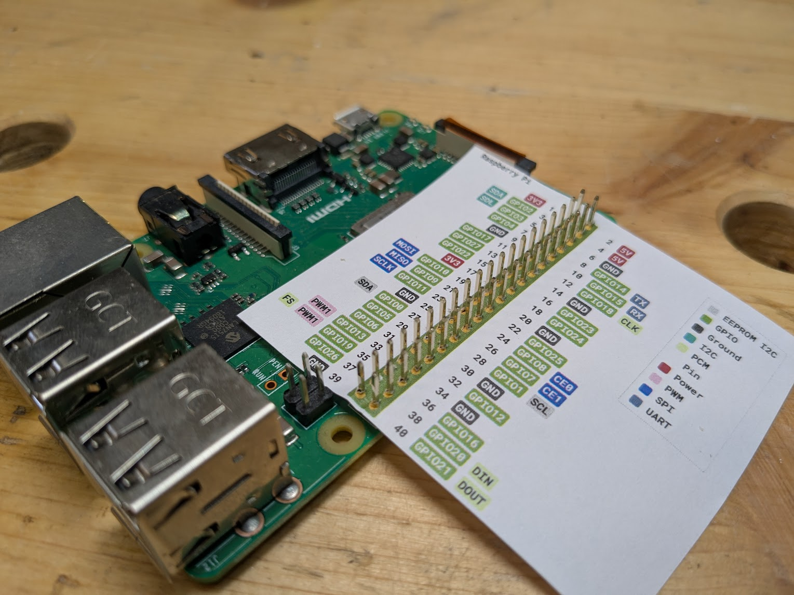
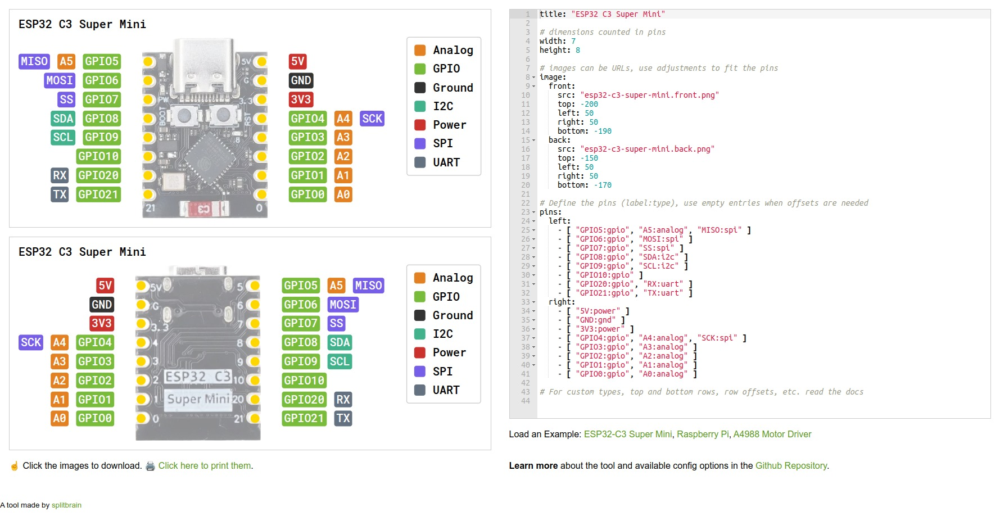

# Pinout Leaf Generator 🌿

Pinout diagrams for microcontrollers and other PCBs are well known, but it can be hard always comparing the pinout diagram with the real PCB, counting pins. One solution is to print out a diagram that has exactly the right size to push the pins through the paper and have the labels right next to the actual pin.

This project is meant for easily creating such pinout leaves.

The pins can be described by a simple YAML-based description and the tool automatically creates the diagram as an SVG.

Give it a try: **[🚀 Open Web Editor](https://splitbrain.github.io/pinoutleaf/)**



## Features

* **SVG Output:**
  * Generates clean, scalable SVG diagrams.
  * Default sizes match the real-world PCB exactly — just print at 100%.
  * Fully self-contained, font and image resources are embedded into the file so it's fully portable.
  * Images can be PNG, JPEG, GIF, WebP, AVIF, BMP or SVG, from local files or `https://` URLs.

* **Configuration:**
  * Define pinouts, board dimensions, labels, and types using simple YAML or JSON files.
  * Custom types allow control over colors and legend labels.

* **Web Editor:**
  * Real-time preview of the diagram as you edit the configuration.
  * Syntax highlighting for YAML.
  * Switch PCB images between grayscale and color and adjust their opacity with a slider (sets `grayscale` and `opacity` of the images in the YAML).
  * Download the front, the back or both (as two files or combined into one) as SVG or PNG. PNGs have 300 DPI and print in real size, too.
  * Remote images are embedded into the download. Servers that block this are linked instead, the editor shows a notice when that happens.

* **CLI Tool:**
  * Process multiple configuration files or entire directories to generate SVG diagrams programmatically.

* **Front & Back Views:**
  * Automatically generates diagrams for both the front and back sides of the PCB.

* **Photo First Layouts:**
  * Start with a photo of your PCB and place pin headers on it by clicking their first and last hole.
  * The pin pitch is used to derive the real-world scale, no fiddling with image offsets.
  * Front and back photos can be placed independently.

## Screenshot



## Limits

  * Grid layouts: only four rows of pins are supported (left, right, top, bottom) on the standard 0.1-inch raster.
  * Photo first layouts: pins within a header are equally spaced along a straight line. Labels always point left, right, up or down.

## Alternatives

- [Youtube: Feather Diagrams Walk-Through for Adafruit](https://www.youtube.com/watch?v=ndVs1UvK6AE) — doing it the manual way in Inkscape
- [GenPinoutSVG](https://github.com/stevenj/GenPinoutSVG) — a Python tool using CSV files as input
- [Pinion](https://yaqwsx.github.io/Pinion/) — creates pinout diagrams from KiCAD PCB files
- [PCBDraw](https://github.com/yaqwsx/PcbDraw) — another KiCAD-based tool
- [Integrated Circuit Pinout Diagram Generator](https://github.com/cmfcmf/ic-pinout-diagram-generator) — probably closest to this project, but without an editor

None of the tools above focus on dimensional accuracy and printing. They are more about creating diagrams for documentation or web pages.

## Usage

### Web Editor

1. Go to https://splitbrain.github.io/pinoutleaf/
2. Edit the YAML configuration in the editor.
3. The SVG diagrams will update automatically.
4. Click the images to download them.

Feel free to open an issue when you create a new pinout leaf and we can add it to the list of existing leaves.

### Premade Leaves

Check the [pinouts](https://github.com/splitbrain/pinoutleaf/tree/gh-pages/pinouts) directory for boards that have already been defined.

Open a [pull request](https://github.com/splitbrain/pinoutleaf/pulls) or [ticket](https://github.com/splitbrain/pinoutleaf/issues) if you made one and want it included in the repo.

### Photo First Layouts

Instead of describing a pin grid and nudging the image until it matches, you can start with a photo and place the pins on it. Use `headers` instead of `width`, `height`, `offsets` and `pins`:

```yaml
title: "SIM7080G Module"

image:
  front:
    src: "SIM7080G-front-pcb.png"
  back:
    src: "SIM7080G-back-pcb.png"

headers:
  - start: [ 672, 1682 ]   # pixel position of the first hole on the front image
    end: [ 657, 2550 ]     # pixel position of the last hole
    back:                  # optional: the same header on the back image
      start: [ 1728, 1695 ]
      end: [ 1728, 2518 ]
    pins:
      - [ "DTR:uart" ]
      - [ "PWR" ]
      - [ "RTS:uart" ]
      - [ ]                # a hole without labels
      - [ ]
      - [ ]
      - [ "3V3:power" ]
      - [ "GND:gnd" ]
```

1. Set the front (and back) image and add a header with its `start` and `end`.
2. In the web editor, check **📍 Pick coordinates**, put the editor cursor where the coordinates should go and click the hole on the photo. The pixel coordinates are inserted for you. Clicking the back photo gives back image coordinates.
3. Add as many entries to `pins` as the header has holes. The holes are spaced equally between `start` and `end`.
4. Label the pins just like in grid layouts.

Things to know:

* Coordinates are in image pixels. For SVG images they are in the units of the SVG's `viewBox`.
* The distance between the holes and the pin pitch determine the scale of the photo. Until a header with at least two pins exists, the diagram is marked as *not to scale*.
* `pitch` sets the pin spacing in mm, either globally or per header. It defaults to `2.54`.
* `count` sets the number of holes when you don't want to list every pin yet.
* Use `null` (an empty list item) instead of `[ ]` to skip a hole.
* `side` (`left`, `right`, `top`, `bottom`) sets where labels are drawn. It is guessed from the header's position when omitted and mirrored for the back view. Use `back.side` to override it for the back.
* The back photo is scaled and rotated so its holes match the front ones. Without `back` coordinates, it is centered at the front image's scale. Without a back image, the front photo is mirrored.
* `back` `start` and `end` must point to the same first and last pin as on the front. Check the console for warnings when things don't line up.

### Printing

* Download the SVG and open it in an SVG-capable tool — your browser is fine.
* Print and make sure your application or printer driver does not apply any scaling (scale: 100%).
* Optionally poke holes in the marked pin holes with a needle.
* Carefully push your PCB's pins through the paper; using a jumper wire can help with that.
* Enjoy the labels next to the pins.

### Command-Line Interface (CLI)

1. Clone the repo.
2. Install dependencies:
   ```bash
   npm install
   ```
3. Build the project (for web editor and CLI):
   ```bash
   node build.js
   ```
4. Run the CLI tool with configuration files or directories as arguments:
   ```bash
   node public/dist/cli.js path/to/your/config.yaml
   ```
5. The tool will generate corresponding `.svg` files (e.g., `config.front.svg`, `config.back.svg`) in the same directory as the input files.

### Local Setup

If you want to run the web editor locally, you have two options:

1. **Using Node.js:**
   - Clone the repository.
   - Install dependencies:
     ```bash
     npm install
     ```
   - Start a local server:
     ```bash
     npm run serve
     ```
   - Open your browser and navigate to `http://localhost:8080`.
2. **Use your own web server and prebuilt sources:**
   - Copy the [gh-pages](https://github.com/splitbrain/pinoutleaf/tree/gh-pages) branch to your web server document root.

Please note that for both cases, because of CORS, images will not be embedded into the SVG files, an error will be logged to the console, and the images will be linked instead. This is not a problem when using the CLI tool or using the online editor.

## Configuration Syntax

Diagrams are configured using YAML or JSON files. Most things have sensible defaults.

Note: only YAML is supported in the web editor.

### title

Defines the title of the diagram:

```yaml
title: "My PCB"
```

### size

The size of the PCB is defined in the number of pins (assuming a standard pin raster of 0.1 inch, aka 2.54mm). Everything else is derived from this size. Best to put your board on a breadboard and count.

```yaml
width: 4
height: 6
```

### pins

The tool supports up to four rows of pins: `left`, `right`, `top`, and `bottom`. If your board does have a different layout, you're out of luck.

For each row, you define an array of pins. For each pin, you define an array of `label:type` strings. You can have empty pins in a row.

```yaml
pins:
  left:
    - [ "GPIO5:gpio", "A5:analog", "MISO:spi" ]
    - [ "GPIO6:gpio", "MOSI:spi" ]
    -
    - [ "GPIO20:gpio", "RX:uart" ]
    - [ "GPIO21:gpio", "TX:uart" ]
  right:
    -
    -
    - [ "5V:power" ]
    - [ "GND:gnd" ]
    - [ "3V3:power" ]
```

### types

Types define the background color, text color, and legend label for a set of pins. Simply give the type a name, define the properties, and then use it by name in the `pins` definition.

```yaml
types:
  mytype:
    label: 'Special Pins'
    bgcolor: '#ff00ff'
    fgcolor: '#000000'
```

There are the following predefined types, which you can use without defining them yourself:

- `gpio`
- `power`
- `gnd`
- `i2c`
- `uart`
- `spi`
- `analog`

### image

For nicer diagrams, you can define background images (JPEG or PNG only) to use instead of the general green PCB background.

You can set a front and back side image separately. Images can be referenced as local files or as URLs. In both cases, the generator will try to actually embed the image in the generated SVG as a Data URL.

By default, your image will be stretched to exactly match the size defined by the pins. However, your picture will probably not fit exactly. Using the `left`, `right`, `top`, and `bottom` properties, you can define offsets from the respective edges.

Negative numbers will move the image edge outward, positive numbers inward. The offsets are given in hundredths of a millimeter, e.g., 100 is 1mm. Best to interactively experiment in the web editor until the image fits.

```yaml
image:
  front:
    src: "esp32-c3-super-mini.front.png"
    top: -200
    left: 50
    right: 50
    bottom: -190
  back:
    src: "https://example.com/productimage.jpeg"
    top: -150
    left: 50
    right: 50
    bottom: -170
```

By default, images are shown at half opacity and grayscale. This is usually a good idea to make the labels and pins more legible when printing. For documentation, you might want to show the image in full color and opacity. You can do this by setting the `opacity` and `grayscale` properties.

```yaml
image:
  front:
    src: "esp32-c3-super-mini.front.png"
    grayscale: false
    opacity: 1
```

### offsets

By default, the pin rows will sit on the edges of the defined board size. Sometimes you might want to define your board's size larger than the actual pin area. You can use the offsets setting to move a pin row further in.

For example, the Raspberry Pi has two rows of pins all the way to the right edge of a much larger board. In this case, you might want to define the overall size of the board but then offset the left row of pins so it moves over nearly to the right edge.

Only use positive integers and be sure not to push your row outside of the size dimensions.

```yaml
offsets:
  left: 0
  top: 0
  right: 0
  bottom: 0
```

# License

MIT License

Copyright (c) 2025 Andreas Gohr

Permission is hereby granted, free of charge, to any person obtaining a copy
of this software and associated documentation files (the "Software"), to deal
in the Software without restriction, including without limitation the rights
to use, copy, modify, merge, publish, distribute, sublicense, and/or sell
copies of the Software, and to permit persons to whom the Software is
furnished to do so, subject to the following conditions:

The above copyright notice and this permission notice shall be included in all
copies or substantial portions of the Software.

THE SOFTWARE IS PROVIDED "AS IS", WITHOUT WARRANTY OF ANY KIND, EXPRESS OR
IMPLIED, INCLUDING BUT NOT LIMITED TO THE WARRANTIES OF MERCHANTABILITY,
FITNESS FOR A PARTICULAR PURPOSE AND NONINFRINGEMENT. IN NO EVENT SHALL THE
AUTHORS OR COPYRIGHT HOLDERS BE LIABLE FOR ANY CLAIM, DAMAGES OR OTHER
LIABILITY, WHETHER IN AN ACTION OF CONTRACT, TORT OR OTHERWISE, ARISING FROM,
OUT OF OR IN CONNECTION WITH THE SOFTWARE OR THE USE OR OTHER DEALINGS IN THE
SOFTWARE.
